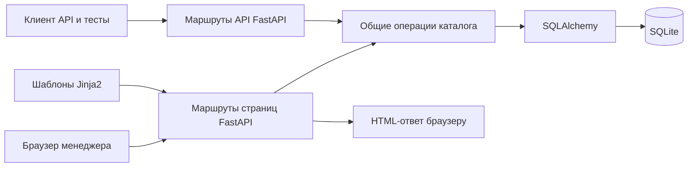
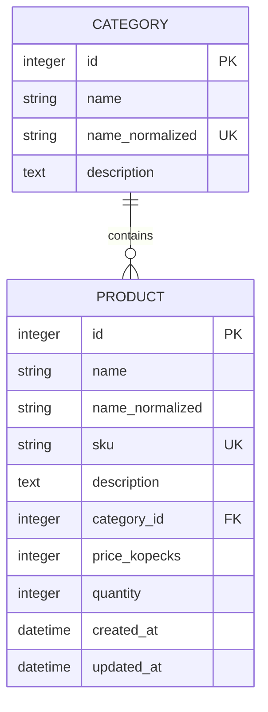

**Этап 2. Проектирование модуля управления каталогом товаров**

Пользователь подтвердил концепцию и общий план. Локальная система — macOS; дополнительных требований преподавателя нет. Выбраны Python 3.12, FastAPI, Jinja2, SQLAlchemy 2, SQLite и Uvicorn. Ниже описана целевая структура приложения. На этапе 3 уже созданы минимальный `app/main.py`, виртуальное окружение и зависимости; база данных и операции каталога еще не реализованы. Указанные ниже ограничения и маршруты — наши проектные решения, а не требования МФЮА.

**Назначение и границы**

Менеджер небольшого учебного интернет-магазина ведет товары и категории, ищет товары, отбирает их по цене и наличию и изменяет текущий остаток. Для демонстрации используем канцелярские товары. Данные обозначаются как учебные. Первая версия рассчитана на локальную работу одного менеджера. Оплата, заказы, доставка, учет отдельных складских движений, варианты товара, авторизация и загрузка изображений в согласованный обязательный объем не входят.

**Как взаимодействуют компоненты**



Браузер отправляет запрос, FastAPI выбирает обработчик. Для изменения данных обработчик проверяет ввод и вызывает общую операцию каталога. SQLAlchemy выполняет запрос к SQLite. HTML-маршрут подготавливает страницу или перенаправляет на нее; API-маршрут возвращает JSON и код результата. Сам браузер к файлу базы не обращается.

Синхронные обработчики и синхронный SQLAlchemy достаточны для этой версии. Сеанс базы открывается на запрос и закрывается после него. Изменения фиксируются одной транзакцией; при ошибке откатываются. Глобального общего сеанса на все запросы не будет.

Общие операции помещаем в один модуль `catalog.py`. Отдельные интерфейсы репозиториев, фабрики сервисов и дополнительные архитектурные слои для этого масштаба не требуются.

**Будущая структура файлов**

Это схема целевой структуры. На этапе 3 созданы только `app/__init__.py`, `app/main.py`, файлы зависимостей, настройки Git и инструкция запуска; остальные компоненты добавляются по согласованным этапам.

```text
kyyyyyrsach/
├── app/
│   ├── __init__.py
│   ├── main.py
│   ├── database.py
│   ├── models.py
│   ├── schemas.py
│   ├── catalog.py
│   ├── routers/
│   │   ├── __init__.py
│   │   ├── pages.py
│   │   └── api.py
│   ├── templates/
│   │   ├── base.html
│   │   ├── error.html
│   │   ├── products/
│   │   │   ├── list.html
│   │   │   ├── detail.html
│   │   │   ├── form.html
│   │   │   └── delete.html
│   │   └── categories/
│   │       ├── list.html
│   │       ├── form.html
│   │       └── delete.html
│   └── static/
│       ├── styles.css
│       └── app.js
├── data/
│   └── catalog.db              # создается при реализации базы; не хранится в Git
├── scripts/
│   └── seed_demo.py            # явное добавление учебных данных
├── tests/
│   ├── conftest.py
│   ├── test_catalog.py
│   └── test_pages.py
├── .gitignore
├── requirements.txt
├── requirements-dev.txt
└── README.md
```

| Файл или папка | Ответственность |
|---|---|
| `main.py` | Создание приложения, подключение маршрутов и статических файлов |
| `database.py` | Адрес базы, подключение и получение сеанса; включение внешних ключей SQLite для каждого соединения |
| `models.py` | Две таблицы, их связь, индексы и ограничения |
| `schemas.py` | Правила входных данных и формат ответов API; общий ввод из JSON и форм |
| `catalog.py` | Создание, изменение, удаление, выборки и проверки правил каталога |
| `routers/pages.py` | Обработка страниц и форм |
| `routers/api.py` | JSON-интерфейс тех же операций |
| `templates/` | Структура страниц; общий макет в `base.html` |
| `static/` | Оформление и небольшие улучшения интерфейса |
| `tests/` | Проверки на отдельной временной базе |
| `requirements*.txt` | Зафиксированные зависимости запуска и тестирования |
| `README.md` | Проверенные инструкции запуска для macOS и облачной среды |

Виртуальное окружение `.venv`, рабочая база, временные файлы и кэши исключаются из Git. Путь к базе определяется относительно каталога проекта, чтобы запуск из другой директории случайно не создавал вторую базу. Демонстрационные данные добавляются отдельной командой, а не автоматически при каждом старте. Повторное добавление набора не должно дублировать товары или изменять уже отредактированные данные.

**Модель данных**



Категория может не содержать ни одного товара. У каждого товара должна быть ровно одна существующая категория. Идентификаторы назначаются базой. Названия товаров могут повторяться, артикулы — нет.

| Таблица | Поле | Правило |
|---|---|---|
| `categories` | `id` | Первичный ключ |
| `categories` | `name` | От 1 до 100 символов после удаления пробелов по краям |
| `categories` | `name_normalized` | Служебное нормализованное название; обязательное и уникальное |
| `categories` | `description` | Необязательное описание, до 2000 символов |
| `products` | `id` | Первичный ключ |
| `products` | `name` | От 1 до 200 символов после удаления пробелов по краям |
| `products` | `name_normalized` | Служебное нормализованное название для поиска и сортировки |
| `products` | `sku` | Обязательный уникальный артикул длиной до 64 символов |
| `products` | `description` | Необязательное описание, до 2000 символов |
| `products` | `category_id` | Обязательный внешний ключ на `categories.id`; удаление занятой категории запрещено |
| `products` | `price_kopecks` | Неотрицательное целое число в пределах целочисленного типа SQLite |
| `products` | `quantity` | Неотрицательное целое число в пределах целочисленного типа SQLite |
| `products` | `created_at` | Назначается приложением при создании, хранится в UTC |
| `products` | `updated_at` | Обновляется приложением при изменении, хранится в UTC |

Даты пользователю показываются в местном времени браузера с обозначением зоны. Служебные поля менеджер не заполняет и через API не изменяет.

Категория и товар сохраняют удобное для показа название с исходным регистром. Служебное название формируется одинаковым преобразованием Unicode и приведением регистра через `casefold`; крайние пробелы удаляются. Это позволяет считать «Бумага» и «бумага» одной категорией и искать русские названия без учета регистра. Нормализованное поле не показывается в форме. Все пути записи, включая учебные данные, должны поддерживать его согласованность с названием.

Артикул в первой версии состоит из латинских букв, цифр, дефиса и подчеркивания, например `PEN-001`. При сохранении буквы приводятся к верхнему регистру, поэтому `pen-001` не создаст дубликат `PEN-001`. Это выбранное нами правило, о нем будет подсказка в форме.

Цена вводится и возвращается API в рублях десятичной строкой, например `"149.90"`; в форме разрешается десятичная запятая. При разборе используется точное десятичное представление и максимум два знака после разделителя. Скрыто округлять более точный ввод нельзя. В базе `149.90` рубля хранятся как `14990` копеек. Ноль допустим. Бесконечность, NaN, отрицательные значения и переполнение отвергаются. Количество допускает только целые значения, без дробной части.

Уникальность обеспечивается ограничениями базы, а понятные сообщения — приложением. Неотрицательность цены и остатка закрепляется проверками базы. Индекс на `category_id` ускоряет выборку категории; уникальные ограничения категорий и артикулов создают соответствующие индексы. Дополнительные индексы добавлять только при обоснованной необходимости.

SQLite должен проверять внешние ключи для каждого подключения. Удаление категории с товарами блокируется и проверкой приложения, и внешним ключом. Каскадного удаления товаров нет. Для удаления категории менеджер сначала меняет категории соответствующих товаров либо явно удаляет сами товары.

Схема создается на этапе 4. Создание отсутствующих таблиц не должно удалять или пересоздавать существующую базу. Последующие изменения схемы потребуют отдельного решения о миграции с сохранением данных.

**Поиск, фильтры и порядок выдачи**

Параметры списка одинаковы для страниц и API:

| Параметр | Назначение |
|---|---|
| `q` | Поиск по части нормализованного названия; пустая строка не ограничивает результат |
| `category_id` | Только товары выбранной существующей категории |
| `min_price`, `max_price` | Включительные границы цены в рублях; можно задать только одну |
| `in_stock` | При включении оставляет товары с количеством больше нуля |
| `sort` | `name_asc`, `name_desc`, `price_asc`, `price_desc`, `updated_desc` |
| `page` | Номер страницы, целое число от 1; по умолчанию 1 |

Размер страницы — 10 товаров. Условия применяются совместно. Нижняя граница цены не может превышать верхнюю. Неизвестное значение сортировки и некорректные параметры отвергаются с пояснением. Если указан корректный, но отсутствующий идентификатор категории, возвращается ошибка отсутствия категории. Если категории не заданы, доступны все товары.

По умолчанию товары сортируются по нормализованному названию. При одинаковом значении основного ключа используется `id`, чтобы порядок между страницами оставался стабильным. Это порядок по нормализованным строкам Unicode, без обещания специальной словарной сортировки для всех языков.

Символы `%` и `_` в поиске считаются введенными пользователем символами, а не шаблонами SQL. Значения передаются параметрами запросов; сортировка выбирается из известного списка. При переходе между страницами все условия сохраняются. Новая отправка фильтров начинает с первой страницы. Кнопка «Сбросить» очищает условия.

Пустая выдача — нормальный результат, а не ошибка. Показываются число найденных товаров, текущая страница и навигация; если страница превышает доступный диапазон, предлагается вернуться к первой. Товары с нулевым остатком видны, пока не выбран фильтр наличия.

**Экраны и действия пользователя**

| Экран | Что находится на нем |
|---|---|
| Список товаров | Поиск, фильтры, сортировка, кнопка добавления, таблица, число результатов, пагинация |
| Карточка товара | Артикул, название, категория, описание, цена, остаток, даты, ссылки редактирования и удаления |
| Форма товара | Все редактируемые поля; подсказки и сообщения рядом с неверными значениями; кнопки сохранения и отмены |
| Подтверждение удаления | Название удаляемого товара, предупреждение об удалении записи, кнопки подтверждения и отмены |
| Категории | Список с количеством товаров и действиями; переход к созданию |
| Форма категории | Название и описание; создание или переименование с сохранением связи с товарами |
| Удаление категории | Подтверждение для пустой категории; объяснение блокировки и ссылка на товары для занятой |
| Страница ошибки | Понятная причина и переход к списку, например при обращении к удаленному товару |

Если категорий еще нет, на форме товара предлагается сначала создать категорию. Если список товаров пуст, показывается предложение добавить первый товар. Если ничего не найдено по фильтру, предлагается изменить условия. При ошибке ввода заполненные корректные значения сохраняются.

Условный макет списка, а не скриншот готовой программы:

```text
КАТАЛОГ                                      [+ Добавить товар]
Товары  |  Категории

Поиск [____________________]
Категория [Все ▾]  Цена от [____] до [____]  [ ] В наличии
Сортировка [По названию ▾]          [Найти]  [Сбросить]

Найдено товаров: ...
Артикул | Название | Категория | Цена | Остаток | Действия
...     | ...      | ...       | ...  | ...     | Открыть / Изменить

                          [Назад]  Страница ...  [Вперед]
```

Условный макет формы:

```text
НОВЫЙ ТОВАР
Название *     [________________________]
Артикул *      [________________________]
Категория *    [Выберите категорию     ▾]
Цена, руб. *   [________]
Количество *   [________]
Описание       [________________________]
               [________________________]

                      [Сохранить] [Отмена]
```

Оформление: светлый серый фон, белые блоки, темный текст, один синий акцент для основных действий. Удаление выделяется красным, наличие сопровождается текстовой меткой. Отступы, кнопки и поля одинаковы на всех страницах; меню показывает текущий раздел. Это исходное решение оформления, которое можно уточнить при реализации.

На узком экране фильтры располагаются столбцом, таблица доступна с горизонтальной прокруткой. Поля имеют видимые подписи, ошибки поясняются текстом. Цвет дополняет сообщения, но не заменяет их. Базовые операции с формами работают без JavaScript; небольшой JavaScript помогает отображать даты и улучшает удобство. До преобразования даты браузером доступно исходное значение с обозначением UTC. Макеты, названия и примерные данные не являются результатами запущенного приложения.

**Маршруты страниц**

GET открывает страницу. Изменяющие действия выполняются POST. Подтверждение удаления открывается отдельно и само ничего не удаляет.

| Метод | Путь | Действие |
|---|---|---|
| GET | `/` | Перенаправить на список товаров |
| GET | `/products` | Список, поиск и фильтры |
| GET | `/products/new` | Форма нового товара |
| POST | `/products` | Создать товар |
| GET | `/products/{id}` | Карточка товара |
| GET | `/products/{id}/edit` | Форма редактирования |
| POST | `/products/{id}/edit` | Сохранить изменения |
| GET | `/products/{id}/delete` | Запросить подтверждение удаления |
| POST | `/products/{id}/delete` | Удалить товар |
| GET | `/categories` | Список категорий |
| GET | `/categories/new` | Форма новой категории |
| POST | `/categories` | Создать категорию |
| GET | `/categories/{id}/edit` | Форма категории |
| POST | `/categories/{id}/edit` | Сохранить категорию |
| GET | `/categories/{id}/delete` | Подтверждение либо объяснение запрета |
| POST | `/categories/{id}/delete` | Удалить пустую категорию |

Успешное сохранение формы завершается перенаправлением с кодом 303, чтобы обновление страницы не повторяло запись. После создания или изменения товара открывается карточка; после удаления — список. Операции категорий возвращают к их списку. Статические маршруты вроде `new` регистрируются до маршрутов с идентификатором.

**Маршруты API**

| Метод | Путь | Результат |
|---|---|---|
| GET | `/api/products` | Список с полями `items`, `total`, `page`, `page_size` |
| POST | `/api/products` | Создание, ответ 201 |
| GET | `/api/products/{id}` | Товар, ответ 200 |
| PUT | `/api/products/{id}` | Замена редактируемых полей товара, ответ 200 |
| DELETE | `/api/products/{id}` | Удаление, ответ 204 без тела |
| GET | `/api/categories` | Список категорий |
| POST | `/api/categories` | Создание, ответ 201 |
| GET | `/api/categories/{id}` | Категория, ответ 200 |
| PUT | `/api/categories/{id}` | Замена редактируемых полей категории, ответ 200 |
| DELETE | `/api/categories/{id}` | Удаление пустой категории, ответ 204 без тела |

Пример представления цены в ответе: `price: "149.90"`. Служебные нормализованные поля и внутренняя цена в копейках в публичный формат не входят. При PUT передаются все редактируемые поля; частичное обновление PATCH в первую версию не включается. Стандартная документация FastAPI `/docs` позволит выполнять запросы без отдельного инструмента.

**Ошибки и сохранение данных**

| Ситуация | Ответ и поведение |
|---|---|
| Пустое обязательное поле, неверная цена, дробный остаток, плохие фильтры | 422; указание ошибочного поля или параметра |
| Несуществующий товар или категория | 404; понятное сообщение |
| Повторный артикул или название категории | 409; сохраненные записи не меняются |
| Удаление занятой категории | 409; товары и категория сохраняются |
| Пустой список товаров | 200; пустое состояние или предложение изменить поиск |

API возвращает JSON, страницы — HTML с понятными сообщениями и сохраненным вводом. Проверка в браузере полезна для удобства, но сервер повторяет проверку всегда. Ограничения базы остаются последним уровнем защиты целостности. Любая ошибка записи должна откатывать текущую транзакцию, сохраняя возможность следующего корректного запроса.

**Пример полного пользовательского сценария**

1. Менеджер создает категорию «Письменные принадлежности».
2. Открывает «Добавить товар» и вводит учебный товар: «Ручка синяя», артикул `PEN-001`, цену 49,90 рубля, остаток 20 и созданную категорию.
3. Сервер проверяет поля, уникальность артикула и наличие категории, сохраняет цену как 4990 копеек и открывает карточку.
4. Менеджер находит товар по запросу «РУЧКА», выбирает категорию и фильтр «В наличии».
5. Меняет цену и остаток, затем видит новые значения.
6. Попытка удалить категорию блокируется, пока к ней относится товар.
7. После отдельного подтверждения менеджер удаляет товар; пустую категорию теперь можно удалить.

Этот сценарий запланирован для проверки после реализации; сейчас он не выполнялся.

**Связь требований с проектом и будущими проверками**

| Требование | Где реализуется | Как будем проверять |
|---|---|---|
| Добавление товара | Форма, API, операция каталога, таблица товаров | Созданная запись доступна в карточке и базе |
| Просмотр списка | Страница списка и GET списка API | Видны созданные товары, корректны число и страницы |
| Редактирование | Общая форма, PUT API, операция каталога | Изменились выбранные данные, идентификатор сохранен |
| Удаление | Подтверждение, POST страницы, DELETE API | Запись исчезла; повторный запрос дает отсутствие |
| Категории | Страницы, API, связь таблиц | Создание, переименование, уникальность, запрет удаления занятой |
| Поиск | Нормализованное имя, общий запрос выборки | Русские названия находятся в разном регистре; спецсимволы буквальны |
| Фильтрация | Общие параметры списка | Категория, обе границы цены, наличие и их сочетания |
| Сортировка | Разрешенные значения порядка | Корректный порядок и стабильность равных значений |
| Остаток | Поле количества и фильтр наличия | Целое неотрицательное значение; ноль скрывается только фильтром |
| Подробная информация | Карточка и GET одного товара | Все пользовательские поля соответствуют сохраненным |

Отдельно проверим сохранение данных после перезапуска, ошибки ввода, откат после конфликтной записи, работу пустого каталога и пагинацию. Тесты используют временную базу и не затрагивают рабочий каталог пользователя. Результаты и количество выполненных тестов будут записаны только после их действительного запуска.

**Материалы для курсовой и критерии завершения этапа**

- Параграф 2.1: сценарии менеджера и таблица соответствия требований функциям.
- Параграф 2.2: схема «категория — товары», словарь полей, ограничения и обоснование цены в копейках.
- Параграф 2.3: схема компонентов, структура проекта и макеты интерфейса.
- Для главы 3 позже сохраняем реальные скриншоты списка, карточки, формы, фильтрации и ошибки валидации, а также фактические результаты запросов и тестов.

Сейчас скриншоты приложения делать не требуется: работающих экранов еще нет. Схемы Mermaid служат рабочими материалами проектирования. При включении в записку оформить их по требованиям Word и согласованным правилам авторских иллюстраций.

Проектирование подготовлено: определены файлы, таблицы, связи, ограничения, маршруты, экраны и проверки. Все десять согласованных основных функций имеют место в проекте. На этапе 3 добавлено минимальное приложение: GET `/` пока возвращает JSON с сообщением о проекте, GET `/health` проверяет ответ сервера. Целевые маршруты каталога выше будут реализованы позже. Подготовка и фактические проверки начального приложения описаны в [STAGE_3.md](STAGE_3.md); проверки товарного каталога еще не выполнялись.
