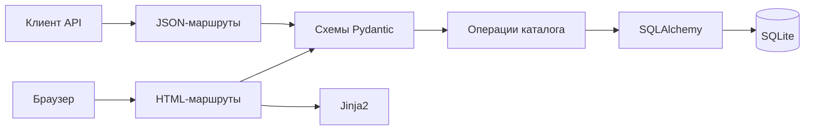
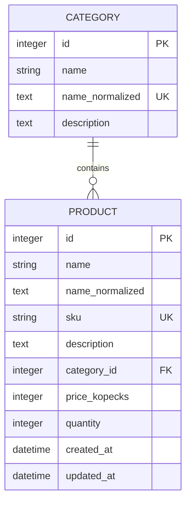

# Устройство приложения

Модуль рассчитан на локальную работу менеджера с товарами и категориями. Стек: Python 3.12, FastAPI, Jinja2, SQLAlchemy, SQLite и Uvicorn. [Требования](REQUIREMENTS.md), [проверки](TESTING.md) и [комплект документов](SUBMISSION.md) описаны отдельно.

## Компоненты

| Файл | Назначение |
|---|---|
| `app/main.py` | Создание приложения, маршруты, обработчики ошибок и инициализация схемы |
| `app/database.py` | Путь базы, движок, внешние ключи и сессия на запрос |
| `app/models.py` | Таблицы, связи, ограничения и подготовка значений |
| `app/schemas.py` | Входные схемы, публичные ответы, цена и фильтры |
| `app/catalog.py` | Создание, чтение, изменение, удаление, поиск и транзакции |
| `app/routers/api.py` | JSON API и HTTP-статусы |
| `app/routers/pages.py` | Чтение форм, выбор шаблонов и перенаправления |
| `app/web.py` | Шаблоны, сообщения проверки, форматирование цен и дат |
| `app/templates/` | Списки, карточка, формы, подтверждения и ошибки |
| `app/static/` | Адаптивное оформление и перевод дат в местное время |
| `app/demo_data.py`, `scripts/seed_demo.py` | Генерация примеров, резервная копия и загрузка |
| `tests/` | Проверки базы, API, HTML и загрузчика |

Страницы и API вызывают одни функции `catalog.py`. Операция сообщает о конфликте через `CatalogError`, а слой представления выбирает JSON или HTML. Шаблоны не выполняют запись в базу.

## Модель данных

Категория может не иметь товаров. Товар всегда относится к одной существующей категории. Её переименование сохраняет связи; перенос товара меняет `category_id` без создания копии товара.

Названия хранятся в исходном написании и в нормализованной форме: NFKC, удаление крайних пробелов, `casefold`. Нормализованное имя используется для поиска и уникальности категории. Артикул приводится к верхнему регистру. Цена хранится целыми копейками; ввод в рублях разбирается через Decimal. Допустимые типы, длины и диапазоны перечислены в [технических требованиях](requirements/REQUIREMENTS.md).

Для каждого соединения выполняется `PRAGMA foreign_keys=ON`. Внешний ключ с `ON DELETE RESTRICT` запрещает удаление занятой категории. Проверка приложения даёт понятное сообщение, а ограничение базы действует при записи.

Даты хранятся без встроенного часового пояса по соглашению UTC. API обозначает UTC, JavaScript может показывать местное время браузера. Нормализованные поля и внутреннее число копеек не входят в публичную схему товара.

## Поиск и страницы списка

| Параметр | Поведение |
|---|---|
| `q` | Часть названия без учёта регистра; `%`, `_` и `/` ищутся буквально |
| `category_id` | Товары существующей категории |
| `min_price`, `max_price` | Включительные границы цены в рублях |
| `in_stock` | При `true` количество строго больше нуля |
| `sort` | `name_asc`, `name_desc`, `price_asc`, `price_desc`, `updated_desc` |
| `page` | Страница от 1; размер страницы — 10 товаров |

Условия применяются совместно. Нижняя цена не может превышать верхнюю. Отсутствующая категория даёт 404, неверные параметры — 422. Если значения выбранного поля равны, записи упорядочиваются по `id`. Сортировка названия выполняется по нормализованным строкам Unicode без отдельной словарной сортировки языка.

Один список условий используется для подсчёта и выборки страницы. Ссылки пагинации сохраняют фильтры через `urlencode`; новая отправка формы начинает поиск с первой страницы. Пустая выдача с допустимыми условиями остаётся успешным результатом.

## HTML-маршруты

| Адрес | GET | POST |
|---|---|---|
| `/` | Перенаправление на `/products` | Нет |
| `/products` | Список и фильтры | Создание товара |
| `/products/new` | Форма нового товара | Нет |
| `/products/{id}` | Карточка товара | Нет |
| `/products/{id}/edit` | Форма изменения | Сохранение |
| `/products/{id}/delete` | Подтверждение | Удаление |
| `/categories` | Список и счётчики товаров | Создание категории |
| `/categories/new` | Форма новой категории | Нет |
| `/categories/{id}/edit` | Форма изменения | Сохранение |
| `/categories/{id}/delete` | Подтверждение или причина запрета | Удаление пустой категории |

GET читает данные. После успешной изменяющей HTML-операции используется 303 и отдельный GET, поэтому обновление карточки не повторяет отправку формы. При 422 или 409 форма сохраняет введённые значения. Числа из HTML сначала разбираются адаптером, затем проверяются общей строгой схемой.

Меню и кнопки используют текстовые подписи без декоративных значков. На узком экране фильтры и поля выстраиваются столбцом, таблица прокручивается в собственном контейнере. Пользовательский текст экранируется Jinja2; основные формы работают без JavaScript.

## JSON API

| Адрес | Операции |
|---|---|
| `/api/categories` | GET списка, POST создания |
| `/api/categories/{id}` | GET, PUT, DELETE |
| `/api/products` | GET списка с фильтрами, POST создания |
| `/api/products/{id}` | GET, PUT, DELETE |

В API десять операций. Создание возвращает 201, чтение и изменение — 200, удаление — 204 без тела. Неверный ввод даёт 422, отсутствующий объект — 404, конфликт уникальности или связи — 409.

При PUT передаются все обязательные редактируемые поля. Лишние входные поля запрещены. Цена принимается строкой рублей, например `"49.90"`; количество и идентификатор категории — строгими целыми JSON-числами. PATCH не реализован. Схема доступна по `/openapi.json`, Swagger — по `/docs`.

## Транзакции и хранение

Сессия выдаётся на запрос через `get_db`. Изменяющая операция явно фиксирует транзакцию. После `IntegrityError` выполняется `rollback`; известные конфликты преобразуются в `CatalogError`. Неизвестное нарушение повторно возбуждается как исключение.

Обычная база находится в `data/catalog.db`, путь вычисляется от папки проекта. При запуске создаются отсутствующие таблицы. Существующие записи не удаляются, миграция уже созданной схемы не выполняется. Тесты и браузерный сервер используют отдельные временные базы.

Текущая реализация использует SQLite. Перенос на PostgreSQL потребует проверки SQLite-специфичных ограничений `typeof`, `GLOB`, настроек подключения и миграции. Нагрузочная и многопользовательская работа не проверялись.
