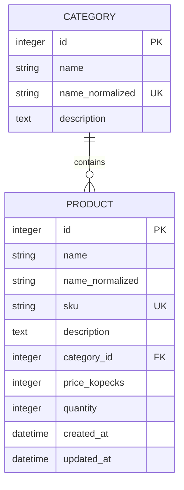

# Этап 4. Подключение к SQLite и модели данных

Протокол этапа 4: таблицы категорий и товаров, сеансы SQLAlchemy и создание схемы при запуске FastAPI. API и страницы были добавлены позднее.

## Файлы и их назначение

| Файл | Назначение |
|---|---|
| [app/database.py](../app/database.py) | Путь к базе, объект Engine, включение внешних ключей, фабрика сеансов и создание таблиц |
| [app/models.py](../app/models.py) | Модели Category и Product, связь между ними, ограничения и подготовка значений |
| [app/main.py](../app/main.py) | Вызов создания таблиц в обработчике жизненного цикла приложения |
| [tests/conftest.py](../tests/conftest.py) | Отдельная временная база для каждого теста |
| [tests/test_database.py](../tests/test_database.py) | Проверки сохранения, связей, ограничений и повторного запуска |

Новые библиотеки не понадобились: используются зависимости, установленные на этапе 3.

## База и создание таблиц

Рабочая база — `data/catalog.db` относительно корня проекта. Путь вычисляется из расположения `database.py`, а не из текущей папки терминала. SQLAlchemy получает путь через `URL.create`, поэтому специальные символы в пути не становятся частью параметров URL.

Создание объекта Engine само по себе не создает файл. При запуске FastAPI обработчик `lifespan` вызывает `init_db()`: создается папка `data`, затем недостающие таблицы. При завершении приложения освобождаются соединения пула. Повторный запуск не удаляет существующие записи.

`create_all()` не меняет структуру уже существующих таблиц. При последующих изменениях схемы нужно отдельно проектировать миграцию с сохранением данных; удаление рабочей базы не является штатным способом обновления.

Файл базы и его служебные файлы исключены из Git. На новом компьютере из исходников создается пустая схема, а не копия чужого каталога.

## Таблицы и связь



Категория может существовать без товаров. У товара должна быть ровно одна существующая категория. Поля `products` и `category` в моделях SQLAlchemy позволяют переходить между связанными объектами; в самой таблице связь хранится как `category_id`.

Удаление непустой категории запрещено внешним ключом с `ON DELETE RESTRICT`. Событие подключения выполняет `PRAGMA foreign_keys=ON` для каждого нового соединения SQLite. Без этого SQLite не обязана применять объявленный внешний ключ.

`passive_deletes="all"` в связи не позволяет ORM обнулить ссылки товаров при удалении категории. Решение принимает ограничение SQLite. Тесты проверяют это при загруженной и незагруженной коллекции товаров. Автоматического удаления товаров вместе с категорией нет.

## Правила значений

- Название категории: 1–100 символов; товара: 1–200. Пробелы по краям удаляются.
- Для поиска и сравнения сохраняется служебное название после Unicode-нормализации NFKC и `casefold`. При переименовании оно обновляется. Названия категорий уникальны по этому представлению; названия товаров могут повторяться.
- Артикул содержит 1–64 латинских буквы, цифры, дефисы и подчеркивания. Перед сохранением он приводится к верхнему регистру, а пробелы по краям удаляются. Уникальность обеспечивает база.
- Описание необязательно, до 2000 символов.
- Цена хранится целым количеством копеек: 49,90 рубля — `4990`. Преобразование пользовательского ввода в рублях будет реализовано вместе с входными схемами API.
- Цена и количество неотрицательны. ORM отвергает дробные числа, логические значения и переполнение 64-битного целого. SQLite дополнительно проверяет тип и знак значений.
- Даты создания и изменения назначаются автоматически. SQLite хранит их без обозначения часового пояса; по контракту приложения это UTC. При подготовке ответов API нужно явно обозначить UTC, а локальное отображение появится в интерфейсе.

Подготовка значений в моделях предназначена для записей через ORM. Прямой SQL не выполняет Python-валидаторы, поэтому нормализованные названия при таком обращении должны поддерживаться отдельно. Штатные операции приложения будут работать через модели. Ограничения NOT NULL, UNIQUE, CHECK и внешний ключ действуют и при прямой записи; тесты проверяют числовые ограничения SQL-командами в обход ORM-валидаторов.

## Сеанс и фиксация

Engine управляет подключениями. `SessionLocal` создает сеанс для работы с объектами. `session.add()` регистрирует новую запись, а `session.commit()` фиксирует изменения в файле. После ошибки записи необходим `session.rollback()`, иначе сеанс остается в состоянии неудачной транзакции.

`get_db()` подготовлен для выдачи отдельного сеанса на запрос на следующем этапе. Он закрывает сеанс после использования; автоматического commit в нем нет. Это позволит фиксировать изменения явно в операциях каталога.

## Фактические проверки

В облачной среде выполнена команда:

```bash
.venv/bin/python -m pytest -q
```

Результат: **35 passed, 1 warning**. Проваленных и пропущенных тестов нет.

Проверены:

- Сохранение товара и чтение его из другого процесса Python.
- Повторное создание схемы без удаления записей.
- Уникальность категорий и артикулов без учета регистра.
- Невозможность сохранить товар с несуществующей категорией.
- Запрет удаления занятой категории с сохранением товара и категории после rollback.
- Возможность удалить пустую категорию.
- Запрет отрицательных и дробных значений непосредственно ограничениями SQLite.
- Запрет логических значений и переполнения на уровне ORM.
- Обязательность внешнего ключа, цены и количества.
- Проверка формата артикула, пустых названий и обновления поисковых полей.
- Автоматические даты и сохранение даты создания при изменении товара.
- Независимость пути базы от последующей смены рабочей папки.
- Создание таблиц при запуске приложения и сохранность записей между двумя запусками его жизненного цикла.

Тесты используют временные файловые базы. До первого реального запуска сервера проверено, что они не создали рабочий `data/catalog.db`.

Starlette выдала предупреждение об устаревающем использовании HTTPX в TestClient и рекомендовала HTTPX2. Тесты завершились успешно; версии зависимостей сохранены.

После тестов запущен Uvicorn. Подтверждены ответы 200 для `/`, `/health`, `/openapi.json`, `/docs`, ответ 404 для отсутствующей страницы, наличие файла рабочей базы, обеих таблиц, внешнего ключа с RESTRICT и включенного `PRAGMA foreign_keys`. Рабочая база создана без демонстрационных товаров. GET `/health` по-прежнему подтверждает ответ сервера; отдельная проверка схемы выполняется непосредственно через SQLAlchemy.

## Как проверить на Mac

Остановите ранее запущенный сервер сочетанием Control+C. В корне проекта выполните:

```bash
git pull --ff-only
source .venv/bin/activate
python -m pytest -q
python -m uvicorn app.main:app --reload
```

Если среда еще не настроена, сначала выполните инструкции этапа 3 в [README](../README.md). Факт успешного запуска на компьютере студента пока не подтвержден.

Во втором окне терминала можно проверить структуру. Команда выполняется из корня проекта, когда сервер уже был запущен:

```bash
source .venv/bin/activate
python - <<'PY'
from sqlalchemy import inspect
from app.database import DATABASE_PATH, engine

assert DATABASE_PATH.is_file(), "Сначала запустите приложение"
print("Файл:", DATABASE_PATH)
print("Таблицы:", inspect(engine).get_table_names())
with engine.connect() as connection:
    print("Внешние ключи:", connection.exec_driver_sql("PRAGMA foreign_keys").scalar_one())
engine.dispose()
PY
```

Ожидаются таблицы `categories`, `products` и значение внешних ключей `1`. Эта команда читает структуру и не добавляет товары.

## Использование в курсовой

Параграф 2.2: схема связи, словарь полей, ограничения и обоснование хранения цены в копейках. Параграф 3.1: подключение, создание таблиц, транзакции и нормализация. Параграф 3.3: фактические проверки и таблица ожидаемых и полученных результатов.

После выполнения на Mac сохраните скриншот результата тестов и вывода проверки структуры. Они подтверждают этот этап; скриншоты карточек и форм появятся после реализации интерфейса.

На этапе 4 проверены схема и ограничения SQLite. Позднее студент подтвердил запуск на macOS. Реализация API описана в [STAGE_5.md](STAGE_5.md).
